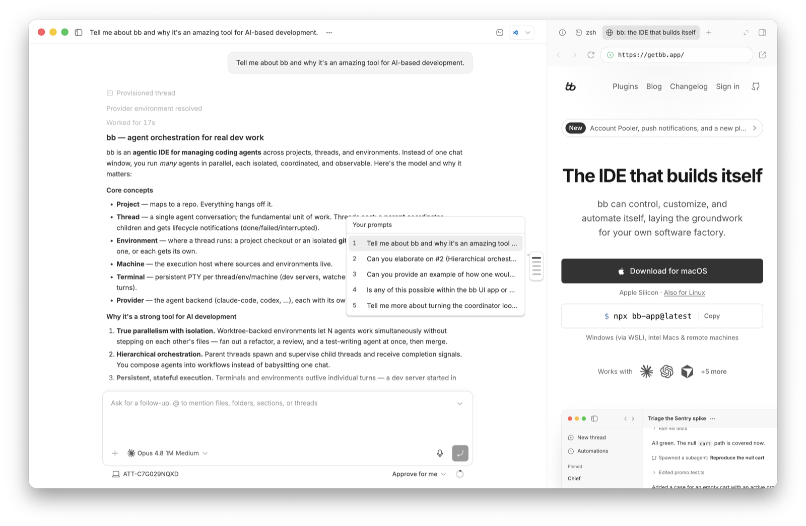

# bb-plugin-threadline

A prompt navigator for long threads. Threadline puts a slim rail on the right
edge of a conversation, one tick per prompt you sent. Hover the rail to preview
any prompt. Click a tick or a preview to jump to that prompt and flash it. The
current prompt stays highlighted as you scroll.

Inspired by [Conductor](https://conductor.build), where I first saw this feature.



## Files

- `server.ts`: the settings, plus three RPCs. `outline` returns the thread's
  conversation outline from `bb.sdk.threads.conversationOutline` (ordered
  messages, each with a preview). `shortcuts` and `setShortcut` read and write
  the previous / next prompt shortcuts in plugin KV storage, broadcasting each
  change over realtime.
- `app.tsx`: an app-wide overlay (`app.slots.experimental_appOverlay`) that reads
  the active thread with `useBbContext()`, draws the rail and popover, and
  scrolls the timeline. It also registers the **Keyboard shortcuts** settings
  section and the command palette actions.
- `lib/shortcut.ts`: shortcut parsing, recording, matching, and display, shared
  by the server (validation) and the app.
- `CONTEXT.md`: the glossary (rail, tick, popover, windowed rail, and so on).

## How navigation works

The BB timeline is virtualized, so an off-screen prompt is not in the DOM. Each
row carries `data-timeline-row-id`, which equals the outline item id for user
messages. Long threads are also paged: only the newest events are loaded, and
an older page loads when you scroll near the top.

To reach an off-screen prompt, the overlay interpolates (or extrapolates) from
the rendered rows' measured offsets until the target row mounts, then centers
it with a brief highlight. Only if that runs into the top with the target still
older than everything rendered does it page in history: it parks at the top and
waits for pages to arrive (the content grows, or BB shows "Loading older
messages…") until the oldest rendered prompt is at or before the target. After
paging it holds the target in view briefly, since a page still in flight can
finish and BB's anchor restore would drag the view away. The target tick pulses
meanwhile; reaching the first prompt of a ~17k-event thread takes ~6s.

BB's timeline sticks to the bottom and only releases on real wheel / touch /
key input, so a bare programmatic scroll gets snapped back on the next resize.
Before each scroll the overlay dispatches a non-bubbling synthetic wheel on the
scroller to release it. Scrolling or typing yourself cancels a jump in flight.

The active prompt is whichever user row sits nearest the top of the viewport,
recomputed as you scroll. Scrolled to the bottom, the newest visible prompt
wins instead, so a just-sent prompt is highlighted right away. The rail is anchored to the conversation pane, not the
app window, and re-anchors when the pane resizes (for example when the right
panel opens).

## Long threads

The rail never grows past half the pane's visible height. As prompts pile up
the ticks pack tighter; once they can't fit, the rail shows a window of prompts
that follows the current one, with `+N` counts (clickable) for what's hidden
above and below. Scroll the wheel over the rail to slide the window.

The popover opens on the current prompt, shows `current / total`, and adds a
filter box past 15 prompts (Enter jumps to the first match). With
`scrollToHover` on, hovering a tick scrolls the popover to its row: lined up
with the tick while the rail shows every prompt, centered once it's windowed,
and paused while filtering.

Previous / next prompt: `Ctrl+Alt+↑` / `Ctrl+Alt+↓` by default, or the command
palette's "Threadline: Previous prompt" / "Threadline: Next prompt".

## Configure

The frontend reads settings with `useSettings()`, so changes apply without a
reload.

- `position`: where the rail sits: `Top`, `Middle` (default), or `Bottom` (just
  above the chat input).
- `hideBuiltInToc`: hide BB's built-in thread table of contents (default on).
  BB has no switch for it, so Threadline hides `[data-thread-toc]` with a
  stylesheet it removes when turned off or unloaded.
- `scrollToHover`: sync the popover to the hovered tick (default on). Off opens
  it centered on the current prompt.

```
bb plugin config threadline
bb plugin config threadline set position Bottom
```

### Keyboard shortcuts

Previous / next prompt shortcuts are set in Threadline's settings page under
**Keyboard shortcuts**: click one, press the keys (Esc cancels, Backspace turns
it off), or Reset to the default. BB's keybinding settings only cover its own
commands, so Threadline records, stores (plugin KV storage, not `bb.settings`,
which would also render a free-text field), and matches them itself
(`lib/shortcut.ts`). The server broadcasts each change so every open window
picks it up.

## UI components

Threadline keeps only what it uses: `lib/utils.ts` (the `cn` helper) and
`@radix-ui/react-hover-card` for the popover. React, the radix portal primitives,
and the SDK come from BB at runtime and are never bundled, so they stay in
`devDependencies` for typechecking. `components.json` still points at the BB
registry, so `npx shadcn add @bb/select` can vendor more components on demand.

## Install

From the published release:

```
bb plugin install "git:https://github.com/frankieshakes/bb-plugin-threadline.git@semver:0.x"
```

`0.x` tracks every 0.* release, so `bb plugin outdated` / `bb plugin update`
pick up new minor versions. Avoid a caret range here: below 1.0, `^0.2.0`
means `<0.3.0`, so 0.3.0 would never show as an update. BB fixes the range at
install time; to change it, `bb plugin remove threadline` and install again
(this resets Threadline's settings and shortcuts).

From source:

```
npm install
bb plugin install .
```

After editing sources, reload (or run `bb plugin dev` to rebuild on save):

```
bb plugin reload threadline
```

## Types and API reference

After `npm install`, the full API is on disk:

```
node_modules/@get-bb/plugin-sdk/bundled-types/bb-plugin-sdk.d.ts      # backend
node_modules/@get-bb/plugin-sdk/bundled-types/bb-plugin-sdk-app.d.ts  # frontend
```

Run `bb plugin types` to sync the SDK pin to the running BB, and `bb plugin build`
before publishing.
